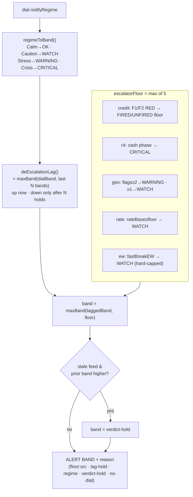
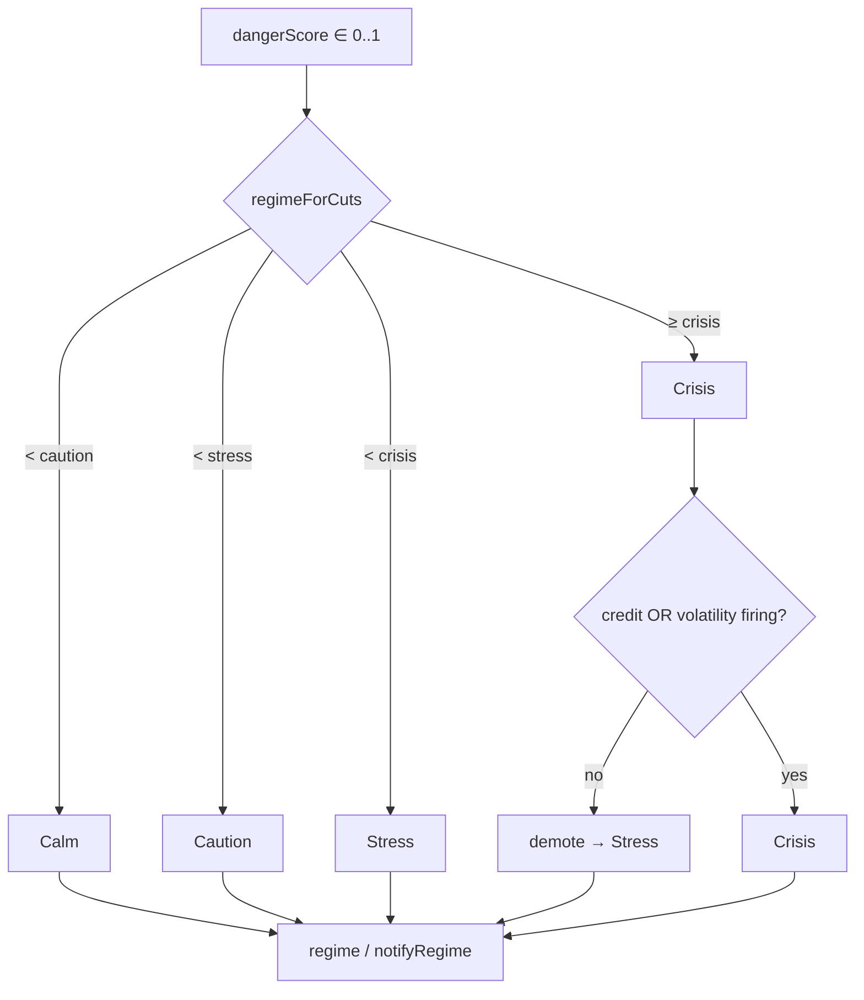
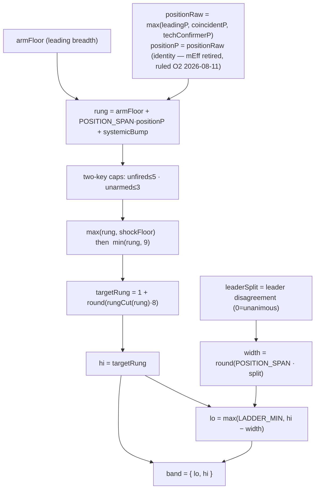
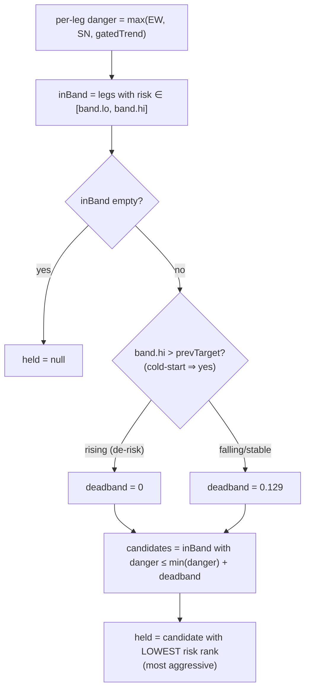

# Dial logic explainer — 4 core calculations

Concise, as-built (verified against code 2026-07-22). Each section: short text + one diagram.
Source symbols: `src/alert-band.ts`, `src/t1dial.ts`, `src/families.ts`, `src/danger-engine.ts`.

Shared primitive — **`rung`** (a continuous 1–9 position) drives everything below.
`dangerScore = rungCut(rung) = (rung − 1) / 8 ∈ [0,1]`. `targetRung = 1 + round(dangerScore·8) ≈ round(rung)`.

---

## 1. Alert band (the pushed OK / WATCH / WARNING / CRITICAL)

The band is the **max of two lifts** over the dial: the (lag-held) dial band, and the highest of 5
independent *escalator floors*. It can only ever LIFT — an escalator never lowers the dial. A `verdictHold`
guard can hold yesterday's band while a feed is stale. `computeAlertBandDetail` (`alert-band.ts`).

---

## 2. Regime (Calm / Caution / Stress / Crisis)

A pure cut-table over `dangerScore`, then a **Crisis gate**. Two axes share the *same code* but different
cuts: `regime` (display, `DIAL_REGIME_CUTS`) and `notifyRegime` (notify, `NOTIFY_REGIME_CUTS = rungCut(3/5/7)
= 0.25 / 0.50 / 0.75`). The gate demotes a scored Crisis to Stress unless credit **or** volatility is
actually firing — so credit-blind deep rungs can't claim the top label. `regimeFor`/`applyCrisisGate`.

---

## 3. Dial band `[lo, hi]` (min & max rung)

`hi` is the depth-selected **target rung**; `lo` widens *downward* only by how much the leaders
**disagree** (`leaderSplit`, Gini/2). Unanimous leaders → zero width → `lo = hi` (a point). The rung itself
is an ARM floor + within-band position, clamped by the **two-key caps** (unfired ≤ 5, unarmed ≤ 3; rungs
7–9 need both keys) and a graded unarmed `shockFloor`. `computeT1Dial` (`t1dial.ts`). Constants:
`POSITION_SPAN=2`, `LADDER_MIN=1`, `LADDER_MAX=9`.

---

## 4. Held leg (which sleeve to hold)

Filter legs to those whose **risk rank** sits inside the dial band, then pick the **most-aggressive**
(lowest risk rank) leg whose danger is within a directional `deadband` of the calmest one. Each leg's
danger is a worst-of `max(EARLY-WARN, STRESS-NOW, gatedTrend)`. The deadband is **asymmetric**: de-risk
instantly (deadband 0 → strict calmest), but resist re-risking to a more-defensive leg on a sub-band gap.
`computeField` (`danger-engine.ts`). `DERISK_DEADBAND = 0`; `RERISK_DEADBAND = DANGER_CUTS.amber / 2`
— **derived, never a literal**, so read it off `danger-engine.ts` (or `/api/danger-model`'s
`reriskDeadband`) rather than from this sentence. At the cuts shipped on 2026-08-07 that is `0.1206`;
it was `DANGER_CUTS.amber` until that date and was HALVED there as the counterweight to the retired timing gates.

The two re-risk TIMING gates are retired (same date, same plan): `RERISK_CONFIRM = 1` and
`RERISK_DWELL_DAYS = 0`, so a re-risk commits on the first close, exactly like a de-risk. The only
surviving re-risk brake besides this deadband is the trend veto (a confirmed-RED `uT` member).

---

### Cheat-sheet: how they chain

`rung → dangerScore → { regime (§2), band[lo,hi] (§3) }`; `band` filters legs → `held` (§4);
`notifyRegime → dialBand`, lifted by escalator floors → `ALERT BAND` (§1).
The alert band is what gets **pushed**; the held leg is what gets **persisted + shown** as the rotation pick.
